# Recruitment relational model

```mermaid
erDiagram
    users ||--o{ candidates : owns
    users o|--o{ candidates : optionally_links
    candidates o|--o{ candidates : merged_membership
    candidates ||--o{ candidate_certifications : holds
    certifications ||--o{ candidate_certifications : identifies
    candidates ||--o{ source_identities : records
    source_identities ||--|{ source_records : immutable_versions
    import_jobs o|--o{ source_records : ingestion
    import_jobs ||--o{ import_errors : errors
    source_records ||--o{ field_provenance : supports
    candidates ||--o{ field_provenance : fields
    candidates ||--o{ duplicate_reviews : reviewed_pairs
    duplicate_reviews ||--o{ merge_decisions : reversible_decisions
    recruitment_rules ||--|{ rule_versions : versions
    rule_versions ||--o{ evaluations : exact_version
    candidates ||--o{ evaluations : historical_input
    candidates ||--o{ recruitment_applications : applies
    recruitment_applications ||--o| queue_state : prioritized
    queue_state ||--|{ queue_evaluations : evaluation_set
    evaluations ||--|| queue_evaluations : snapshot
    workflow_templates ||--|{ template_versions : versions
    template_versions ||--|{ workflow_nodes : tasks
    template_versions ||--o{ workflow_edges : dependencies
    template_versions ||--o{ workflow_instances : pinned
    recruitment_applications ||--|| workflow_instances : independent
    workflow_instances ||--|{ task_states : execution
    workflow_instances ||--o| offers : exactly_once
    users ||--o{ task_states : responsible
    users o|--o{ Activity_Log : actor
    users ||--o{ stress_runs : executes
    users ||--o| artist_profile_core : profile
    artist_profile_core ||--o{ artist_profile_skills : ordered_skills
    artist_profile_core ||--o{ artist_portfolio_items : portfolio
    artist_profile_core ||--o{ artist_detail_fields : typed_scalars
    artist_profile_core ||--o{ artist_detail_lists : list_headers
    artist_detail_lists ||--o{ artist_detail_list_items : ordered_values
    artist_profile_core ||--o{ artist_detail_extensions : historical_extensions
    artist_profile_core ||--o{ artist_package_core : packages
    artist_package_core ||--o{ package_extras : extras
    users ||--o{ event_core : organizer
    event_core ||--|| event_publication_labels : published_attribution
    event_core ||--|{ event_talent_requirements : requirements
```

Recruitment references explicitly use `ON DELETE RESTRICT` to preserve evidence and running/historical workflow facts. Owned profile/package/event list facts use CASCADE with their parent; immutable historical extensions use RESTRICT. The independent normalization archive has no cascading entity link and rejects UPDATE/DELETE. No recruitment delete API is provided. Optional candidate-to-user links are independent from candidate merge membership.

Keys: source identities `(owner_id, feed, external_id)`; source versions `(identity_id, content_hash)`; certifications unique normalized name; candidate-certification composite key; provenance `(candidate_id,field)`; duplicate pair unique ordered IDs; named rule + version; one active version per named rule; named template + version; node `(version_id,name)`; edges reference both nodes in the same version; applications `(owner_id,submission_key)`; one workflow and queue entry per application; one task per instance/node; one offer per instance; unique queue sequence and global ledger sequence.

Durable scalar queue priority/status is operational state. Evaluation inputs/results, original/normalized source payloads, ledger old/new values, and stress observations are immutable historical snapshots. Graph topology and mutable certifications are relational. The legacy names `artist_profiles`, `artist_packages`, `events`, and `artist_skill_facts` are now compatibility views, not stored JSON caches. See [migration v3](LEGACY_NORMALIZATION.md) for the decomposition and historical snapshot boundaries.
